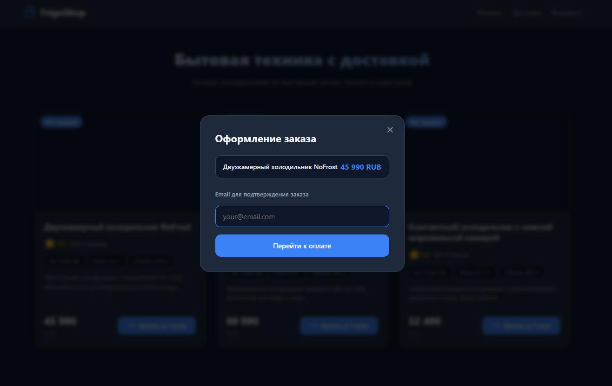
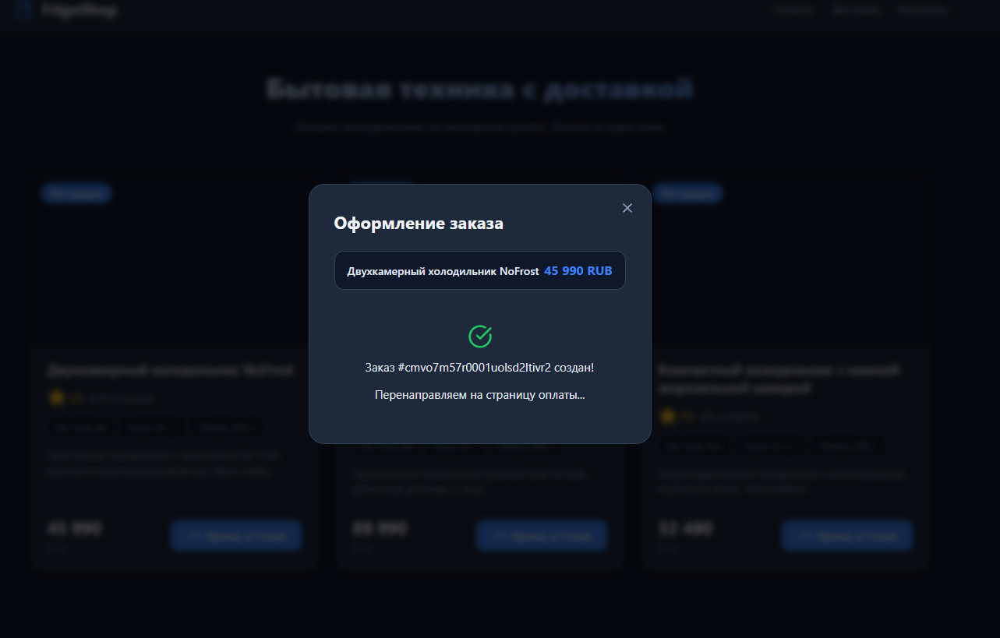
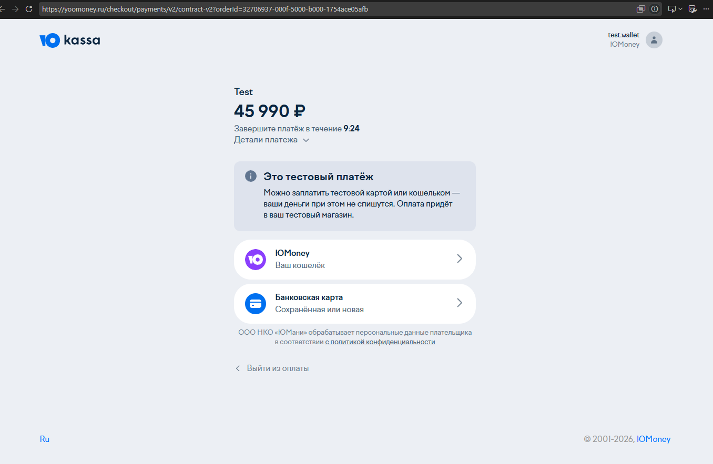
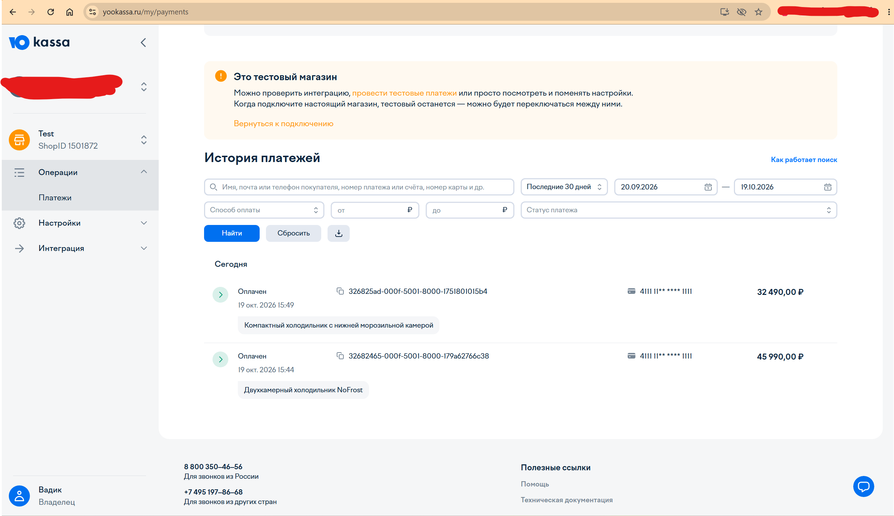
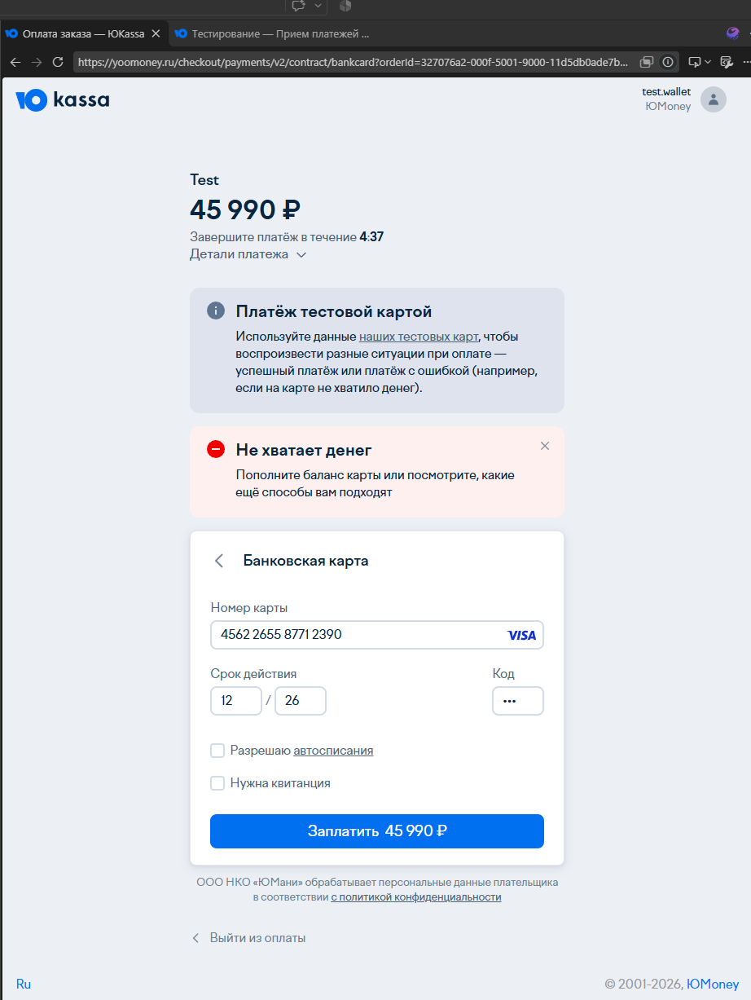
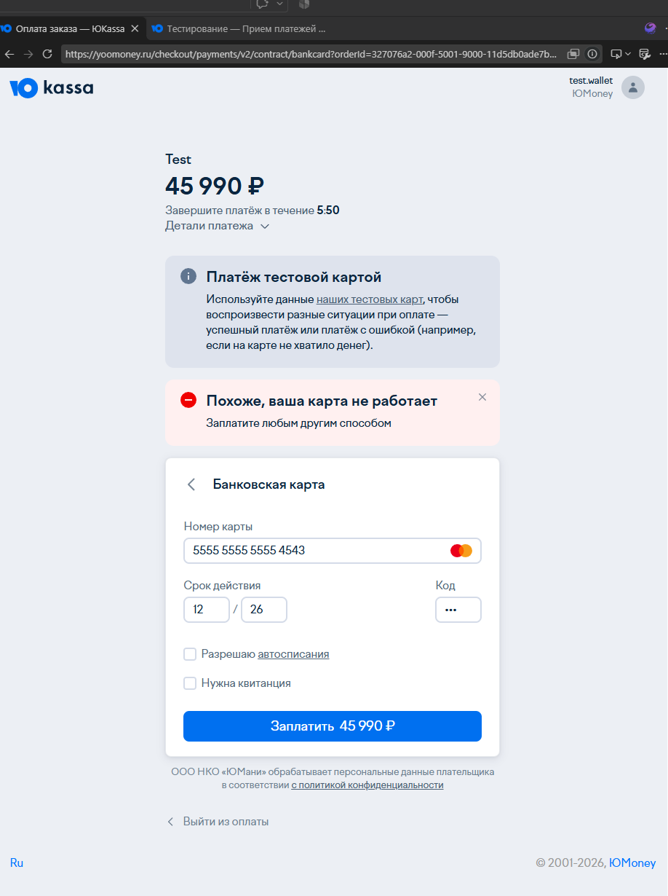

# FrigoShop — Демо-платёжная система

Пет-проект демонстрационной платёжной системы с полной интеграцией онлайн-оплаты (ЮKassa) и локальным эмулятором платёжного шлюза. Каталог товаров захардкожен для демонстрации процесса оплаты.

**Ключевая особенность:** валидация карт по **алгоритму Луна** на клиенте. Клиент проверяет номер карты локально, определяет outcome (success/fail) и отправляет на сервер только `cardLast4` (4 последние цифры). Полные реквизиты карт **никогда не покидают браузер** — это PCI DSS compliant архитектура.

## 🛠 Стек технологий

### Backend
- **Runtime:** Node.js + TypeScript
- **Framework:** Express.js 5
- **Хранение:** In-memory Map (заказы хранятся в оперативной памяти)
- **Валидация:** Zod 4 (декларативная валидация всех входных данных)
- **Безопасность:** Helmet (HTTP headers), CORS, express-rate-limit
- **Тесты:** Jest + Supertest
- **Dev-инструменты:** tsx (hot reload)

### Frontend
- **Framework:** React 19 + TypeScript
- **Build tool:** Vite 6 + @vitejs/plugin-react
- **Routing:** React Router DOM 7
- **Icons:** Lucide React
- **Стили:** Чистый CSS (BEM-подобные классы)

### Платежи
- **Боевой режим:** ЮKassa API v3 (REST, Basic Auth, Webhook)
- **Демо режим:** Mock-шлюз (эмуляция банка с задержкой 2 сек)

## 📐 Архитектура

```
┌─────────────────────────────────────────────────────────────┐
│                     Browser (React Client)                   │
│  ┌──────────┐ ┌──────────┐ ┌──────────┐ ┌──────────┐       │
│  │  Shop    │ │ Payment  │ │ Receipt  │ │ Success  │       │
│  │  Page    │ │  Page    │ │  Page    │ │  Page    │       │
│  └──────────┘ └──────────┘ └──────────┘ └──────────┘       │
│         │              │              │                     │
│         └──────────────┴──────────────┘                     │
│                         │                                   │
│                   fetchJson()                               │
│                   /api/* (Vite proxy)                       │
└─────────────────────────┼───────────────────────────────────┘
                          │ HTTP
┌─────────────────────────┼───────────────────────────────────┐
│                Backend (Express Server)                      │
│                         │                                   │
│  ┌──────────────────────┴──────────────────────────────┐   │
│  │              Controllers Layer                       │   │
│  │  OrderController  │  PaymentController               │   │
│  └────────────────────┬────────────────────────────────┘   │
│                       │                                     │
│  ┌────────────────────┴────────────────────────────────┐   │
│  │              Services Layer                          │   │
│  │  OrderService  │  PaymentService  │  CatalogService  │   │
│  │  (in-memory Map) │  (Adapter Pattern)               │   │
│  │                │  ├── MockPaymentService              │   │
│  │                │  └── YooKassa API (direct fetch)     │   │
│  └──────────────────────────────────────────────────────┘   │
└─────────────────────────────────────────────────────────────┘
```

### Слои приложения

```
Request → Middleware (Helmet, Rate Limit, CORS, Logging)
        → Router (catalog, order, payment)
        → Controller (Zod validation)
        → Service (business logic + in-memory storage)
        → Response
```

## 🏗 Структура проекта

```
refrigerator-pay/
├── server/                     # Backend (Express + TypeScript)
│   ├── src/
│   │   ├── config/
│   │   │   └── env.ts          # Конфигурация (.env)
│   │   ├── controllers/
│   │   │   ├── catalog.controller.ts
│   │   │   ├── order.controller.ts
│   │   │   └── payment.controller.ts
│   │   ├── services/
│   │   │   ├── catalog.service.ts
│   │   │   ├── order.service.ts
│   │   │   ├── payment.service.ts      # Adapter Pattern
│   │   │   └── mock-payment.service.ts # Эмулятор банка
│   │   ├── routes/
│   │   │   ├── catalog.routes.ts
│   │   │   ├── order.routes.ts
│   │   │   └── payment.routes.ts
│   │   ├── types/
│   │   │   └── index.ts          # DTO, интерфейсы
│   │   ├── validators.ts         # Zod-схемы валидации
│   │   └── index.ts              # Точка входа
│   ├── __tests__/                # Unit-тесты
│   │   ├── catalog.service.test.ts
│   │   ├── mock-payment.service.test.ts
│   │   ├── order.service.test.ts
│   │   ├── payment.service.test.ts
│   │   ├── validators.test.ts
│   │   └── setup.ts
│   ├── .env                      # Переменные окружения
│   ├── .env.example              # Шаблон .env
│   ├── package.json
│   ├── tsconfig.json
│   └── jest.config.ts
├── client/                       # Frontend (React + Vite)
│   ├── src/
│   │   ├── components/
│   │   │   ├── Header.tsx / .css
│   │   │   ├── OrderModal.tsx / .css
│   │   │   ├── ProductCard.tsx / .css
│   │   │   └── StatusBadge.tsx / .css
│   │   ├── pages/
│   │   │   ├── ShopPage.tsx          # Каталог товаров
│   │   │   ├── PaymentPage.tsx       # Страница оплаты (PCI DSS)
│   │   │   ├── ReceiptPage.tsx       # Чек об оплате
│   │   │   ├── SuccessPage.tsx       # Успешная оплата
│   │   │   ├── CancelPage.tsx        # Отмена оплаты
│   │   │   └── ...
│   │   ├── services/
│   │   │   └── api.ts                # API-клиент (fetch wrapper)
│   │   ├── types/
│   │   │   └── index.ts              # TypeScript типы
│   │   ├── App.tsx
│   │   ├── main.tsx
│   │   └── index.css
│   ├── vite.config.ts              # Vite + proxy /api
│   ├── package.json
│   └── tsconfig.json
├── docs/
│   └── screenshots/                # Скриншоты для README
├── package.json                    # Workspace root
└── README.md
```

## 🚀 Быстрый старт

### 1. Установка зависимостей

```powershell
# Установка всех зависимостей (workspaces)
npm install
```

### 2. Настройка переменных окружения

```powershell
cd server
Copy-Item .env.example .env
# Отредактируйте .env при необходимости
```

### 3. Запуск

**Вариант A — Один терминал (рекомендуется):**

```powershell
npm run dev
```

Запустит и backend (порт 5000), и frontend (порт 5173) параллельно.

**Вариант B — Два терминала:**

```powershell
# Терминал 1 — Backend
cd server
npm run dev

# Терминал 2 — Frontend
cd client
npm run dev
```

Откройте http://localhost:5173 в браузере.

## 🔌 API

| Метод | Эндпоинт | Описание |
|-------|----------|----------|
| GET | `/api/products` | Получить каталог товаров |
| POST | `/api/orders` | Создать заказ (productId + email) |
| GET | `/api/orders/:id` | Получить статус заказа |
| POST | `/api/payments/create-intent` | Создать платёж, получить URL |
| POST | `/api/payments/mock/process` | Mock-оплата (cardLast4 + outcome) |
| GET | `/api/payments/mock/receipt/:orderId` | Данные чека |
| POST | `/api/payments/webhook` | Webhook ЮKassa |
| GET | `/api/payments/status/:orderId` | Статус заказа (polling) |
| GET | `/health` | Health check |

## 💳 Система платежей

### Adapter Pattern

```
PaymentService (Adapter)
├── PAYMENT_MODE=mock     → MockPaymentService (эмулятор банка)
└── PAYMENT_MODE=yookassa → ЮKassa API v3 (REST)
```

Переключение режима — одна переменная в `.env`:

```env
PAYMENT_MODE=mock           # ← локальный эмулятор (по умолчанию)
PAYMENT_MODE=yookassa       # ← ЮKassa
```

### Mock-шлюз (PCI DSS compliant)

Сервер **никогда не видит полные номера карт**. Клиент валидирует карту локально через алгоритм Луна и отправляет на сервер только `cardLast4` (4 последние цифры) и `outcome` (success/fail).

#### Алгоритм Луна

Алгоритм Луна — стандартная формула для проверки валидности номеров платёжных карт. Работает полностью на клиенте:

1. Берём номер карты и идём **справа налево**
2. Каждую **вторую цифру умножаем на 2**
3. Если результат > 9 — **вычитаем 9**
4. **Складываем все цифры**
5. Если сумма делится на 10 — карта валидна

**Пример с `4111 1111 1111 1111`:**

```
Цифры:        4  1  1  1  1  1  1  1  1  1  1  1  1  1  1  1
Двойные:      8  1  2  1  2  1  2  1  2  1  2  1  2  1  2  1
Сумма: 8+1+2+1+2+1+2+1+2+1+2+1+2+1+2+1 = 30
30 % 10 === 0 ✅ Валидна
```

**Поток оплаты:**

```
Пользователь вводит карту → Луна проверяет → outcome
        ↓
    Если валидна → outcome = 'success' → оплата проходит
    Если не валидна → outcome = 'fail' → отказ
        ↓
    На сервер отправляется только cardLast4 + outcome
```

- Имитация задержки банка: **2 секунды**
- Защита от дублирования: проверка статуса заказа перед обработкой

### ЮKassa интеграция

- Создание платежа через REST API v3
- **Idempotency Key** — защита от двойных списаний
- Webhook-обработчик с верификацией подписи (Content-MD5)
- **Двойная верификация** — проверка платежа напрямую через API ЮKassa
- **Сверка сумм** — копейка в копейку (сравнение amount из webhook и заказа)
- Защита от дублирования webhook (проверка текущего статуса заказа)
- Синхронизация статуса через polling (SuccessPage)

### Тестовые карты (валидные по Луну)

| Банк | Номер | Проверка |
|------|-------|----------|
| SberBank | `4111 1111 1111 1111` | ✅ Сумма = 30, 30 % 10 = 0 |
| Tinkoff | `5213 0000 0000 0002` | ✅ Сумма = 20, 20 % 10 = 0 |
| VTB | `2200 0000 0000 0003` | ✅ Сумма = 30, 30 % 10 = 0 |
| Alfa-Bank | `5469 0000 0000 0003` | ✅ Сумма = 20, 20 % 10 = 0 |

Любой срок действия в будущем + любые 3 цифры CVV.

Любой **невалидный** номер карты (например `1234 5678 9012 3456`) → `outcome = 'fail'` → отказ в оплате.

## 🔒 Безопасность

| Механизм | Реализация |
|----------|------------|
| Helmet | Защита HTTP headers (CSP, X-Frame-Options, и др.) |
| Rate Limiting | 100 запросов/15мин (общий), 10 заказов/15мин (orders) |
| CORS | Разрешён только `CLIENT_URL` |
| Zod валидация | Все входные данные валидируются декларативно |
| PCI DSS | Полные номера карт не отправляются на сервер |
| Idempotency | Ключи для защиты от двойных платежей |
| Webhook verification | Content-MD5 + двойная проверка через API |
| Amount mismatch | Сверка суммы платежа с суммой заказа |
| Email masking | Первая буква + `***@domain` в чеке |

## 🧪 Тесты

```powershell
cd server
npm test              # Запуск тестов
npm run test:watch    # Watch-режим
npm run test:coverage # Отчёт покрытия
```

Покрытие: сервисы (Order, Payment, MockPayment, Catalog), валидаторы (Zod-схемы).

## 📱 Роуты фронтенда

| Маршрут | Страница | Описание |
|---------|----------|----------|
| `/` | ShopPage | Каталог товаров |
| `/payment?orderId=:id` | PaymentPage | Форма оплаты |
| `/receipt/:orderId` | ReceiptPage | Чек об оплате |
| `/success` | SuccessPage | Успешная оплата |
| `/cancel` | CancelPage | Отмена оплаты |

## 🏗 Паттерны проектирования

| Паттерн | Где используется |
|---------|-----------------|
| **Adapter** | PaymentService — делегирование mock/yookassa |
| **Repository** | OrderService, CatalogService — in-memory хранилище |
| **Dependency Injection** | Сервисы принимают зависимости через конструктор (для тестирования) |
| **Validation Schema** | Zod-схемы в `validators.ts` — единая точка валидации |
| **Layered Architecture** | Controller → Service → Response |

## 📸 Демонстрация

### Каталог товаров

*Шаг 2 — Страница каталога*

### Оформление заказа

*Шаг 3 — Создание заказа*

### Страница оплаты

*Шаг 4 — Форма ввода карты (Mock-шлюз)*

### Успешная оплата

*Шаг 5 — Подтверждение оплаты*

### Отказ в оплате

*Шаг 6 — Недостаточно средств*

### Неверные данные карты

*Шаг 7 — Неверные данные карты*

## 📊 Метрики проекта

| Метрика | Значение |
|---------|----------|
| TypeScript файлы | 25 |
| TSX файлы | 11 |
| Всего строк | ~3,550 |
